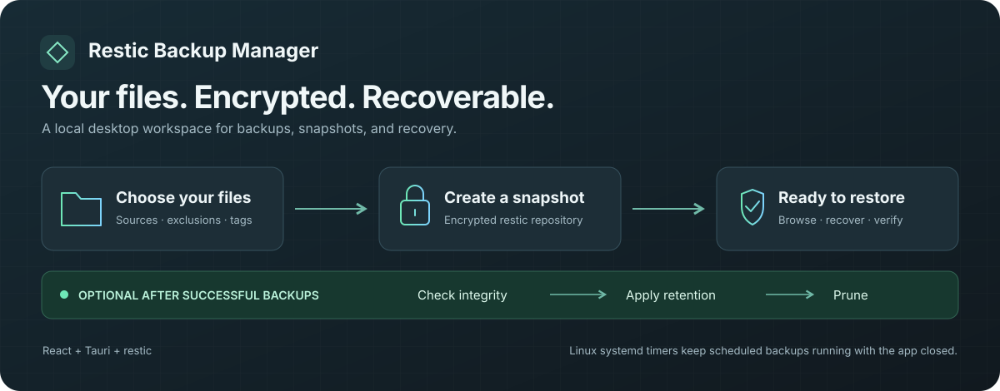
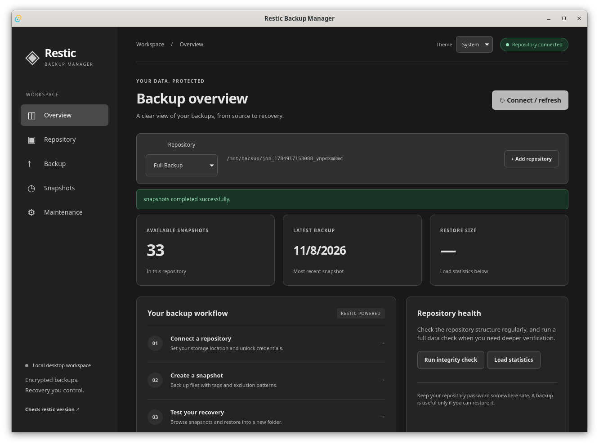

# Restic Backup Manager

A Tauri 2 desktop interface for restic, built with React and TypeScript. Uses real repositories and the `restic` binary on your PATH.



*Backup workflow overview. Scheduled backups use Linux systemd user timers; manual operations also support Windows.*



## Run

Install Node.js, Rust, [Tauri platform prerequisites](https://v2.tauri.app/start/prerequisites/), and [restic](https://restic.readthedocs.io/en/stable/020_installation.html). Then:

```sh
npm install
npm run tauri dev
```

`npm run dev` previews the UI in a browser; commands only execute inside Tauri.

## Build

Run these commands from the project root after installing the prerequisites and running `npm install`:

| Command | Result |
| --- | --- |
| `npm run build` | Type-check TypeScript and build the frontend into `dist/`. |
| `npm run preview` | Preview the built frontend in a browser (run `npm run build` first). |
| `npm run tauri -- build` | Build the release desktop app and all configured package formats for the current platform. |
| `npm run tauri -- build --debug` | Build the desktop app and packages with debug information. |
| `npm run tauri -- build --no-bundle` | Build the release desktop executable without installers or packages. |
| `npm run tauri -- build --bundles deb` | Build a Linux Debian package (`.deb`). |
| `npm run tauri -- build --bundles rpm` | Build a Linux RPM package (`.rpm`). |
| `npm run tauri -- build --bundles appimage` | Build a Linux AppImage. |
| `npm run tauri -- build --bundles deb,rpm,appimage` | Build all three Linux package formats explicitly. |
| `npm run tauri -- build --bundles nsis` | Build a Windows setup executable (`-setup.exe`); run on Windows. |
| `npm run tauri -- build --bundles msi` | Build a Windows MSI installer; run on Windows. |
| `npm run tauri -- build --bundles nsis,msi` | Build both Windows installer formats; run on Windows. |

Tauri build commands automatically build the frontend first. Desktop executables are written under `src-tauri/target/release/` (or `src-tauri/target/debug/` with `--debug`); packages are in the corresponding `bundle/` subdirectory. Package formats depend on the build platform and its installed prerequisites; run the Linux package commands on Linux.

For a specific architecture, use `npm run tauri -- build --target <target-triple>` with the required Rust target and platform toolchain installed. These outputs go under `src-tauri/target/<target-triple>/release/`. Run `npm run tauri -- build --help` for all build options.

### Windows build

On a Windows computer, install Node.js, Rust with the MSVC toolchain, and the [Tauri Windows prerequisites](https://v2.tauri.app/start/prerequisites/#windows) (Microsoft C++ Build Tools with **Desktop development with C++**, and WebView2). From the project root in PowerShell:

```powershell
npm ci
npm run tauri -- build --bundles nsis,msi
```

The setup executable is under `src-tauri/target/release/bundle/nsis/`, the MSI is under `src-tauri/target/release/bundle/msi/`, and the application executable is `src-tauri/target/release/tauri-backup-manager.exe`. Building MSI packages also requires the Windows VBScript optional feature. For an executable without an installer, use `npm run tauri -- build --no-bundle`.

Install restic separately and make `restic.exe` available on PATH on the destination computer. Windows supports manual repository operations; systemd scheduling and managed password-file creation are currently unavailable. You can use an existing password file or a session password.

Linux builds do not produce Windows installers by default. MSI requires Windows; cross-compiling an NSIS installer requires additional tooling described in the [Tauri Windows installer guide](https://v2.tauri.app/distribute/windows-installer/).

## Workflow

1. Open **Repository**, enter the repository location, and supply a session password or an absolute password-file path. Connect an existing repository or initialize a new one.
2. Open **Backup**, enter absolute source paths (one per line), optional excludes and tags. Preview with dry run, then uncheck dry run to create a snapshot.
3. Refresh, open **Snapshots**, and choose **Browse / restore**. Restore all files or an include pattern into a new or empty absolute destination directory. Restored content is verified; existing files are never overwritten.
4. Open **Maintenance** to check metadata or read all stored data. Preview retention before typing `FORGET` to apply. Prune separately to reclaim unreferenced storage.

Profile names, repository locations, source paths, exclusions, tags and password-file paths save automatically in the desktop webview's local storage. Password text stays in React/process memory unless you explicitly use **Create password file**; it is never written to profile storage or command-line arguments. Clearing it removes it from UI state; memory is not explicitly zeroized. Keep an independent copy of your password: losing it prevents recovery.

The app remembers the last selected repository and reconnects on startup using its saved password file, loading its snapshots. Without a password file, it opens Repository settings so you can enter your session password and connect. Connection failures appear in the status message and can be retried with **Connect / refresh**.

Remote backend support uses restic repository URLs and credentials inherited from the environment launching the desktop app. No provider-specific credential manager is included. Avoid credentials in URLs because profile metadata is stored unencrypted.

## Validation

```sh
npm run build
cargo test --manifest-path src-tauri/Cargo.toml --lib
cargo test --manifest-path src-tauri/Cargo.toml --lib -- --ignored --test-threads=1
```

The ignored restic lifecycle test requires restic on PATH. It creates a disposable repository under the system temp directory, tests initialization, backup preview, exclusions, tags, snapshot/file listing, verified restore, refusal of nonempty restore targets, statistics, full data check, retention, pruning, password-file authentication and incorrect-password handling. It does not access your repositories.

## Current limits

Operations execute off the UI thread. Linux manual and scheduled operations share a cross-process lock; scheduled jobs wait while manual operations report when another app operation is busy. Output appears after completion; there is no live progress. Use **Cancel operation** to stop an app-owned restic operation. Keep the app open until the operation finishes or cancellation completes. Activity history is session-only and output is held in memory. Snapshot browsing loads one directory at a time and shows 200 entries per page; a single very large directory still loads in full. Open folders to navigate, use Parent folder to go back, and select a file or use the current folder as the restore filter. Paths are typed rather than selected with native dialogs. Scheduling is available on Linux through systemd user timers. No keychain, repair, manual unlock, mount, copy or key-management workflow yet.

See [implementation plan](docs/PLAN.md) and [review notes](docs/REVIEW.md) for decisions, validation results and next steps.

Restic behavior follows the [official manual](https://restic.readthedocs.io/en/stable/manual_rest.html) and the installed CLI help (tested with restic 0.18.1).

## Imported jobs

The two jobs from `docs/jobs.json` are included as sanitized initial profiles and merged once on the next app startup. Existing profiles are preserved. Select **Full Backup** or **Backup ssh Testing** in the repository selector, then enter the repository password or choose a password file. Passwords from the source JSON are not bundled or saved. The original enabled schedule is not activated; historical backup status and legacy copy options are not migrated.

Run import regression checks with `node tests/profiles.test.ts` (Node.js 22.18+ or 24+).

Choose **System**, **Light**, or **Dark** from the header's **Theme** selector. System is the default and follows OS appearance changes; explicit preferences persist on this device.

## Developer documentation

Open [the static developer reference](docs/index.html) directly in a browser for application flow, function and type contracts, supported operations, and documentation maintenance. No documentation server or dependencies are needed. Source functions include JSDoc and rustdoc comments for editor tooltips; the page also explains how to generate Rust API documentation.

## Automatic stale-lock cleanup

Before each operation on an existing repository, the app runs `restic unlock` with the same repository and credentials. Restic decides which locks are stale; the app never uses `--remove-all` or bypasses repository locking. Initialization and version checks skip cleanup. Cleanup also runs before backup and retention previews, so a preview can remove stale lock files while leaving backup data unchanged. If cleanup fails, the requested operation is cancelled and the error appears in the status message. Cleanup runs when you use a repository, rather than on a background timer.

## Create a password file

In **Repository**, enter the **Session password**, then click **Create password file**. The app creates `~/.local/share/tauri-backup-manager/passwords/<profile-id>.password` and saves its absolute path in the profile. The managed directory is created automatically with owner-only permissions (0700). You can still enter an existing password file manually. On Linux and macOS, the new file is created with owner-only permissions (0600); existing files and symlinks are refused. Empty passwords and passwords containing line breaks are rejected. The password is saved exactly as entered, including spaces. The profile is updated to reference this path, so subsequent repository commands use it. The file contains the plaintext repository password: choose a private directory. Windows creation is currently unavailable because a private ACL implementation is not yet provided.

The Full Backup repository is `/mnt/backup/job_1784917153088_ynpdxm8mc`. A one-time migration corrects the original `/mnt/backup` value for that imported profile, preserving custom paths, password-file settings, and removed profiles. Restart the app to load the correction.

## Cancel long operations

While restic is running, **Cancel operation** appears below the status banner. On Linux/macOS the backend sends SIGINT to its current child process, allowing restic to clean up; after ten seconds it force-terminates a child that has not exited. On Windows it terminates the child directly. Output is retained, cancellation is shown in amber, and loaded repository data is invalidated. Cancellation also applies during the automatic unlock preflight. It cannot stop external processes or processes from an earlier app instance. Changes already made are not rolled back; refresh the repository after cancelling, and use an integrity check after interrupted maintenance. Forced termination can leave a stale lock for the next operation to clean up.

## Scheduled backups (Linux)

1. Configure the repository, sources, exclusions, and tags. Set an existing readable **Password file**, or use **Create password file**. Session-only passwords cannot authenticate unattended backups.
2. Open **Backup → Backup schedule**, select daily or weekly, choose a local time and weekdays, check **Enable scheduled backups**, and click **Save schedule**. Every profile defaults to daily 3:00 AM **disabled**, including Full Backup. No legacy schedule is activated automatically.
3. The panel shows the next timer occurrence, active/waiting state, last result, and the last 100 journal lines (up to 64,000 characters). **Cancel scheduled backup** stops running or queued work. Closing the app does not cancel a scheduled service.

Scheduled jobs always create snapshots; the manual backup dry-run checkbox does not affect them. Automatic maintenance runs after a successful backup when enabled for that profile. Backups run during your systemd user login session, even with the app closed. A persistent timer catches up once after missed runs when the user manager resumes; it does not replay each missed occurrence or wake a sleeping computer. Scheduling before login requires separately configuring systemd user lingering; the app does not change it. Local times and daylight-saving behavior follow systemd and the computer's timezone. Failed runs are recorded without automatic retries.

Schedule metadata and the backup settings snapshot live in `~/.local/share/tauri-backup-manager/schedules/<profile-id>.json`, with mode 0600 inside an owner-only directory. Password text is never included. Last-run results are in `<profile-id>.status.json`. Other app processes share `~/.local/share/tauri-backup-manager/operation.lock`. Do not delete lock files while operations are running; locks are released by closing their descriptors.

Timers and services are named `tauri-backup-manager-<profile-id>.timer` and `.service` under `$XDG_CONFIG_HOME/systemd/user` (default `~/.config/systemd/user`). Saving validates the calendar with `systemd-analyze`, captures the absolute restic executable path, and installs/enables the timer. The service launches the app executable with `--scheduled-backup <profile-id>` before any GUI initialization. AppImages use the original AppImage path. Keep that executable installed at its saved location; after moving or deleting an app/build or restic installation, save schedules again. Development-build timers depend on the development executable continuing to exist.

Saved profile edits synchronize to the scheduled configuration after a short debounce; invalid backup settings disable the timer. The currently running backup uses its loaded settings; later runs use the updated profile. Disabling or removing a schedule stops its timer and service first. Removing a profile preserves repository data and password files. Installation errors restore previous configuration where possible and report recovery errors explicitly.

Scheduled remote backups inherit the **systemd user manager environment**, which may differ from the desktop app or terminal environment. SSH agents, remote provider credentials, and mount availability must work in that session. Missing mounts, unreadable password files, and external active repository locks cause a visible failure; no force-unlock is used. Scheduled cancellation uses SIGINT with a ten-second grace period before forced termination, and service shutdown has a fifteen-second limit. Completed changes are not rolled back.

For troubleshooting (replace `<profile-id>` with the profile's ID):

```sh
systemctl --user status tauri-backup-manager-<profile-id>.timer
systemctl --user status tauri-backup-manager-<profile-id>.service
journalctl --user -u tauri-backup-manager-<profile-id>.service -n 100
```

On other platforms, or without an accessible systemd user session, scheduling is unavailable and manual backups remain available.

### Scheduler checks

```sh
cargo test --manifest-path src-tauri/Cargo.toml --lib
cargo test --manifest-path src-tauri/Cargo.toml --test scheduler_headless
cargo test --manifest-path src-tauri/Cargo.toml --lib scheduler::tests::generated_units_pass_systemd_validation -- --ignored --exact
cargo test --manifest-path src-tauri/Cargo.toml --test scheduler_headless systemd_user_timer_runs_closed_app_and_catches_up -- --ignored --exact
```

The normal headless tests use temporary homes and repositories, cover password-file backups, queued/running cancellation, serialization, validation, and argument forwarding, and do not install timers. The unit verifier creates temporary unit files without activating them. The final, opt-in test needs a real systemd user session and installs uniquely named **runtime** units for generated temporary backup data, verifies app-closed execution and one missed-run catch-up, and removes its units and timer state afterward. It never enables the real Full Backup schedule.

## Automatic maintenance

In **Maintenance → Automatic maintenance**, enable **After each successful backup** for the selected repository. Choose the retention counts (initially 3 last, 7 daily, 4 weekly, and 6 monthly) and optionally enable reading all backup data during the integrity check. Settings save automatically and synchronize to existing scheduled jobs; existing profiles start with automatic maintenance off.

After a successful manual or scheduled backup, the app runs `restic check`, then `restic forget` with the saved automatic retention policy, then `restic prune`. This policy is separate from the manual retention preview controls. Automatic retention deletes snapshots outside the policy and pruning reclaims their unreferenced data. At least one retention count must be positive; invalid policies stop the operation before backup begins. Check uses metadata validation unless reading all data is enabled.

Dry runs, failed backups, incomplete backups (exit 3), and cancelled backups skip maintenance. A failed or cancelled maintenance step stops all later steps. Backup and maintenance share the operation lock and cancellation handling. Results and output include maintenance; a maintenance failure does not undo the completed backup. Scheduled maintenance runs in the same systemd service with the app closed, using its saved password file. Manual maintenance automation also works on Windows; scheduled backups remain Linux-only.
